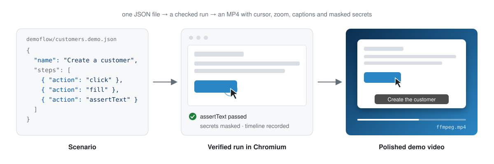
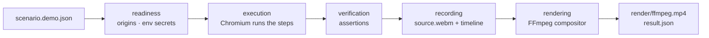
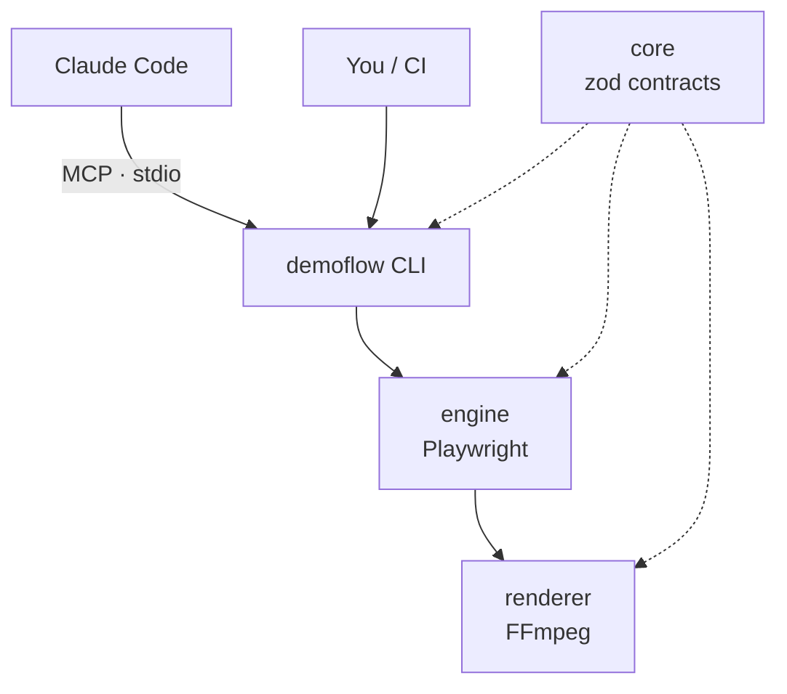

<div align="center">

# DemoFlow

**Verified, polished demo videos of the features you ship — from one JSON scenario.**

[](https://www.npmjs.com/package/demoflow)
[](https://github.com/AndreyBegma/DemoFlow/actions/workflows/execution-plane.yml)
[](LICENSE)
[](https://github.com/AndreyBegma/DemoFlow/wiki)

[Getting started](https://github.com/AndreyBegma/DemoFlow/wiki/Getting-Started) ·
[Wiki](https://github.com/AndreyBegma/DemoFlow/wiki) ·
[CLI reference](https://github.com/AndreyBegma/DemoFlow/wiki/CLI-Reference) ·
[MCP server](https://github.com/AndreyBegma/DemoFlow/wiki/MCP-Server) ·
[Roadmap](https://github.com/AndreyBegma/DemoFlow/wiki/Status-and-Roadmap)

<picture>
  <source media="(prefers-color-scheme: dark)" srcset="docs/assets/hero-dark.svg">
  
</picture>

</div>

DemoFlow drives your web app in Chromium through a short scenario — navigate,
click, fill, assert — and records it. If an assertion fails, the run fails and
the video says so; a demo that shows a broken feature never looks like a
working one.

The recording is then rendered into an MP4 with a smooth drawn cursor, click
rings, camera zoom on the action, captions, idle time compressed, and the page
in a rounded window on a background. Passwords come from environment
variables, never touch disk or logs, and are blurred in the video.

Everything runs on your machine. Run it from the command line, from CI, or let
an AI agent such as Claude Code ask for a demo over MCP.

## Features

| Feature | What it does |
|---|---|
| **[Scenarios](https://github.com/AndreyBegma/DemoFlow/wiki/Scenarios)** | A JSON file with up to 200 steps and accessible-role locators, validated by a JSON Schema. |
| **[Running demos](https://github.com/AndreyBegma/DemoFlow/wiki/Running-Demos)** | `demoflow run` checks readiness, starts your app if configured, runs the steps and renders the video. |
| **[Recording scenarios](https://github.com/AndreyBegma/DemoFlow/wiki/Recording-Scenarios)** | `demoflow record` writes the scenario while you click through the app in a browser. |
| **[Rendering and effects](https://github.com/AndreyBegma/DemoFlow/wiki/Rendering-and-Effects)** | An FFmpeg compositor adds cursor, rings, zoom, captions, key badges, a window frame and a background. |
| **[Secrets and masking](https://github.com/AndreyBegma/DemoFlow/wiki/Secrets-and-Masking)** | `valueFrom.env` keeps secrets out of files and logs; their fields are blurred in the video. |
| **[Run artifacts](https://github.com/AndreyBegma/DemoFlow/wiki/Run-Artifacts)** | Every run leaves the video, a timeline and a `result.json` with per-stage status and exit codes for CI. |
| **[MCP server](https://github.com/AndreyBegma/DemoFlow/wiki/MCP-Server)** | `demoflow mcp` lets Claude Code generate a demo, poll the task and get the video path back. |

> [!NOTE]
> `demoflow@0.1.0` on npm has `run`, `validate`, `setup` and `mcp`. `record`,
> the `press` step, starting the app from `devCommand`, key badges and the
> window frame are on `develop` and ship in the next release, with cards,
> transitions and GIF/WebM export, as do `login` and `logout`. The vertical
> 9:16 export and the Runner connection (jobs, heartbeats, online status) are
> **not built yet** — see [Status and Roadmap](https://github.com/AndreyBegma/DemoFlow/wiki/Status-and-Roadmap).

## How a demo flows



## Architecture



- **Recording is separate from rendering** — the source stays a faithful capture; every effect is applied afterwards from the timeline ([ADR-0004](docs/adr/0004-recording-is-separate-from-rendering.md), [ADR-0005](docs/adr/0005-renderer-chosen-by-spike.md)).
- **Scenarios and config are data, never code** — JSON an agent can write and a person can review ([ADR-0003](docs/adr/0003-scenario-format-and-project-config.md)).
- **Local first** — the browser, your app and your secrets stay on your machine ([ADR-0001](docs/adr/0001-control-plane-execution-plane-one-package.md), [ADR-0008](docs/adr/0008-cloud-boundary.md)).

More in [Architecture](https://github.com/AndreyBegma/DemoFlow/wiki/Architecture).

## Quick start

Needs Node.js 20+. Create `demoflow.config.json` in your project:

```json
{ "baseUrl": "http://localhost:3000" }
```

Write `demoflow/first.demo.json`:

```json
{
  "schemaVersion": 1,
  "name": "Open the settings",
  "steps": [
    { "action": "navigate", "path": "/" },
    { "action": "click", "target": { "role": "link", "name": "Settings" }, "caption": "Open the settings" },
    { "action": "assertVisible", "target": { "role": "heading", "name": "Settings" } }
  ]
}
```

With your app running:

```sh
npx demoflow run demoflow/first.demo.json
```

Chromium is downloaded on first use. The summary prints the path of the video.
To connect Claude Code instead: `claude mcp add demoflow -- npx demoflow mcp`.

### Pair a machine with your account

`demoflow login` prints a code, opens the website, and stores a revocable
device token once you approve the code there. `demoflow logout` revokes it.
Every other command works without an account. See
[`apps/cli/README.md`](apps/cli/README.md#pair-this-machine-with-your-account).

## Documentation

| Where | What |
|---|---|
| [Wiki](https://github.com/AndreyBegma/DemoFlow/wiki) | How to use and operate DemoFlow: one page per feature, configuration, CLI and MCP reference, FAQ |
| [`docs/adr/`](docs/adr/README.md) | Architecture decisions, one per record, superseded never rewritten |
| [`docs/specs/`](docs/specs/README.md) | One specification per issue |
| [`docs/product/`](docs/product/roadmap.md) | Product vision and roadmap |
| [`apps/cli/README.md`](apps/cli/README.md) | The README shipped in the npm package |
| [`deploy/README.md`](deploy/README.md) | Staging deploy and npm release, for maintainers |

## Contributing

Bun workspaces and Turborepo; `bun install`, then `bun run check` and
`bun run test`. Pull requests target `develop`. Local setup (Docker, env files) is in
[Contributing](https://github.com/AndreyBegma/DemoFlow/wiki/Contributing) and [`CLAUDE.md`](CLAUDE.md).

## License

[MIT](LICENSE). The bundled Inter fonts are under the SIL Open Font License 1.1.
